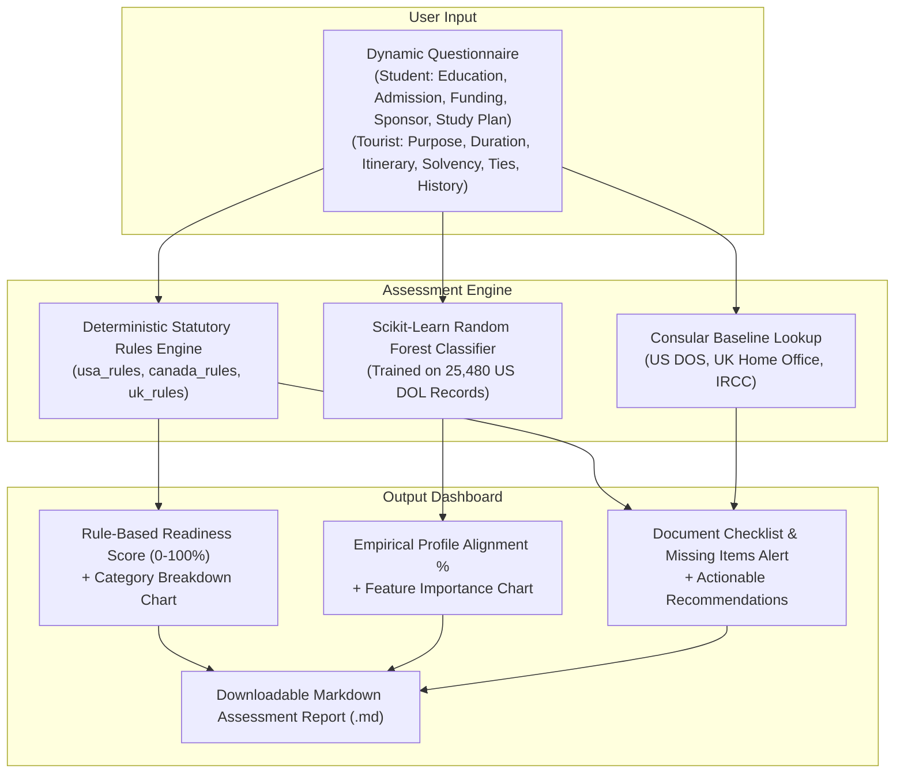

# Multi-Country Visa Readiness & Prediction System

An evidence-based immigration readiness auditor and empirical machine learning benchmarking application for **USA**, **Canada**, and the **United Kingdom**.

Built with **Python 3.12**, **Streamlit**, **Scikit-learn**, **Pandas**, **NumPy**, and **Matplotlib**.

---

## ⚖️ Ethical & Legal Disclaimer
> **Important:** Sovereign consular authorities make visa decisions on a case-by-case basis under respective immigration statutes (such as U.S. INA 214(b), Canadian IRPA, and UK Immigration Rules). No automated or AI software can guarantee visa approval. This platform strictly provides:
> 1. **Rule-Based Readiness Auditing:** Checking your documents and profile against mandatory statutory prerequisites.
> 2. **Empirical ML Benchmarking:** Comparing your profile against 25,480 historical open government visa petition disclosures.
> 3. **No Fabricated Data:** The machine learning model is trained exclusively on bona fide government open datasets (US Department of Labor OFLC disclosures).

---

## 🎯 Target Countries & Visa Categories

| Country | Student / Study Visa | Tourist / Visitor Visa |
| :--- | :--- | :--- |
| **United States 🇺🇸** | **F-1 Student Visa**<br>• Form I-20 & SEVIS I-901 fee<br>• Year-1 liquid funds coverage<br>• Non-immigrant intent (INA § 214(b)) | **B-1/B-2 Tourist Visa**<br>• Day-by-day itinerary & bookings<br>• Employer NOC / leave letter<br>• Economic ties to home country |
| **Canada 🇨🇦** | **Study Permit (Post-Secondary)**<br>• DLI Letter of Acceptance (LOA)<br>• 2024 Provincial Attestation Letter (PAL)<br>• CAD $20,635 living funds + tuition | **Visitor Visa (TRV)**<br>• IMM 5257 & Family Info IMM 5645<br>• IRPA s.179(b) return intent<br>• 6 months certified bank records |
| **United Kingdom 🇬🇧** | **Student Visa (Points-Based System)**<br>• 50 pts: Confirmation of Acceptance (CAS)<br>• 10 pts: English language SELT B2<br>• 10 pts: Maintenance (**28-day holding rule**)<br>• ATAS clearance & TB test | **Standard Visitor Visa**<br>• Appendix V: Genuine visitor test<br>• Proof of earnings & employment<br>• Origin of funds (no sudden lump-sum parking) |

---

## 🏗️ Architecture & Dual-Engine Design



---

## 📂 Project Structure

```text
iotminiprjct/
├── .venv/                         # Isolated Python 3.12 virtual environment
├── data/
│   ├── raw/
│   │   └── EasyVisa.csv          # Genuine US DOL / OFLC visa dataset (25,480 rows)
│   └── reference/
│       └── country_stats.json    # Official US DOS, UK Home Office, and IRCC stats
├── models/
│   ├── visa_model.joblib         # Serialized Scikit-learn Random Forest model
│   └── model_metadata.json       # Feature metadata, accuracy (74%), and ROC-AUC (0.77)
├── src/
│   ├── rules/
│   │   ├── __init__.py
│   │   ├── engine.py             # Unified rules dispatcher
│   │   ├── usa_rules.py          # USA F-1 and B-1/B-2 rules & checklists
│   │   ├── canada_rules.py       # Canada Study Permit and TRV rules & checklists
│   │   └── uk_rules.py           # UK PBS Student (70 pts) and Visitor rules
│   ├── ml/
│   │   ├── __init__.py
│   │   ├── train.py              # Scikit-learn model training script
│   │   └── predict.py            # Model inference & consular lookup
│   ├── ui/
│   │   ├── charts.py             # Matplotlib dimension breakdown & comparison charts
│   │   └── questionnaires.py     # Deep dynamic questionnaires for Student and Tourist
│   └── utils/
│       └── report_exporter.py    # Generates downloadable Markdown assessment reports
├── app.py                         # Streamlit multi-tab web application
├── test_system.py                 # Automated unit and integration test suite
├── requirements.txt               # Pinned project dependencies
└── README.md                      # Documentation & user guide
```

---

## 🚀 How to Run the Application

### 1. Activate the Virtual Environment
Open PowerShell in the project directory:
```powershell
.\.venv\Scripts\Activate.ps1
```

### 2. Launch the Streamlit Web App
Run the following command:
```powershell
.\.venv\Scripts\streamlit.exe run app.py
```
Or via Python:
```powershell
.\.venv\Scripts\python.exe -m streamlit run app.py
```

The application will launch in your browser at `http://localhost:8501`.

---

## 🧪 Running Automated Tests
To run unit and integration tests across all 6 visa categories, ML inference, and chart rendering:
```powershell
.\.venv\Scripts\python.exe test_system.py
```
